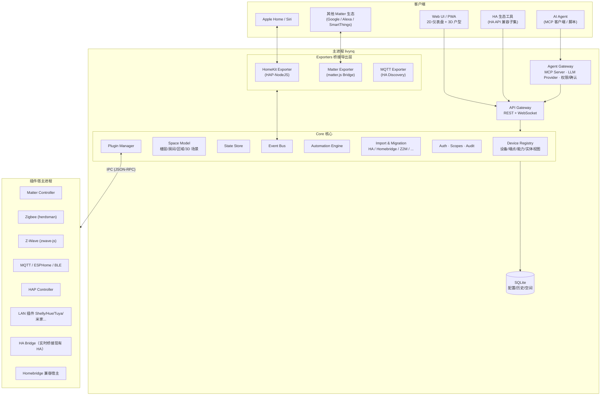
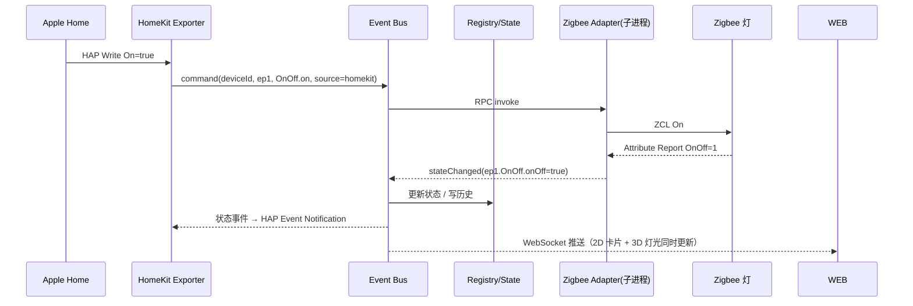
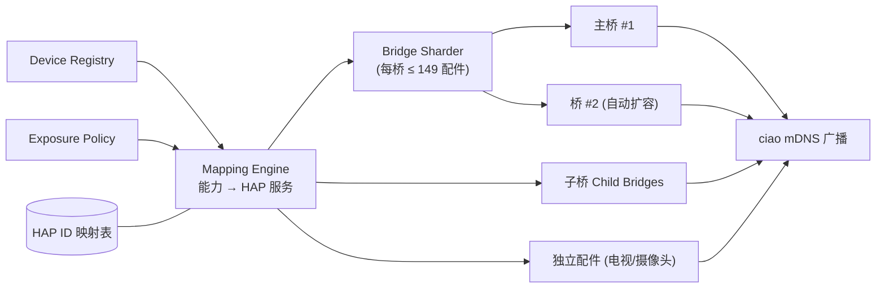
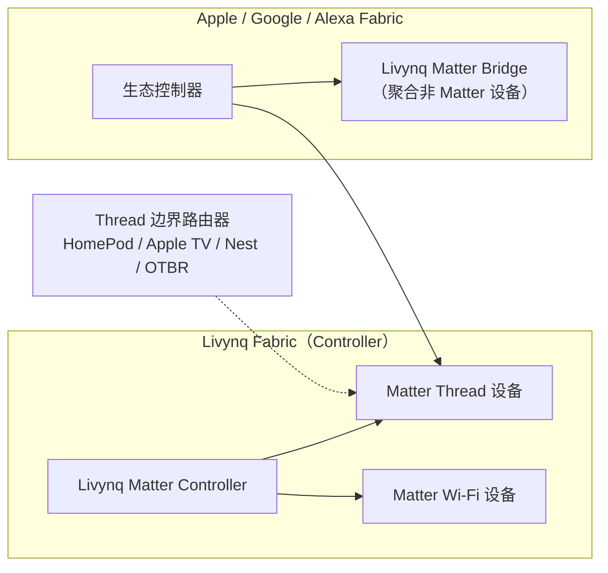

# Livynq 技术方案

> 一个轻量级、本地优先、**Agent 原生**、**空间感知（3D 户型）** 的开源智能家居平台：HomeKit 与 Matter 双一等公民，可无痛导入 Home Assistant / Homebridge / Zigbee2MQTT 现有配置。

| 项目 | 内容 |
| --- | --- |
| 文档版本 | v0.2（草案） |
| 日期 | 2026-10-13 |
| 状态 | 设计评审中 |
| 建议许可证 | Apache-2.0 |

### v0.2 变更摘要

| 需求 | v0.1 | v0.2 调整 | 章节 |
| --- | --- | --- | --- |
| 兼容 Home Assistant 等现有平台 | 仅"HA 桥接插件" + MQTT Discovery | 新增**迁移与兼容层**：HA 配置/注册表/自动化/蓝图导入、HA 实时桥接、HA 风格实体 ID、HA API 兼容子集、Homebridge / Z2M / zwave-js-ui / ESPHome 配置导入 | §7 |
| 兼容主流协议 | HomeKit 为主，Matter 次之 | HomeKit + Matter **双一等公民**；补齐 **Z-Wave**、BLE（BTHome）、Thread 诊断、KNX、Modbus、红外/射频；明确协议矩阵与优先级 | §8–§10 |
| 部署方便、依赖少 | 安装脚本 + 内置 Node | **单文件可执行程序**（Node SEA）、**运行时依赖预算**、HA Add-on、Docker 一行命令 | §5.3、§17 |
| 界面美观 | 卡片式仪表盘 | 独立**设计系统**、主题、墙面平板模式、动效规范 | §15 |
| LLM / MCP / CLI 接口 | 无 | 新增 **Agent Gateway**：内置 MCP Server、LLM Provider 接口、JSON 输出 CLI、安全分级与审计 | §14 |
| 自定义 3D 室内结构 | 无 | 新增**空间模型 + 3D 户型视图**，复用 Pascal Editor（MIT）的 viewer/editor 包；设备在 3D 中落位并实时显示状态 | §16 |

---

## 目录

1. [定位与设计原则](#1-定位与设计原则)
2. [目标与非目标](#2-目标与非目标)
3. [竞品与参考项目](#3-竞品与参考项目)
4. [总体架构](#4-总体架构)
5. [技术选型与依赖预算](#5-技术选型与依赖预算)
6. [核心领域模型](#6-核心领域模型)
7. [Home Assistant 等平台兼容与迁移（新）](#7-home-assistant-等平台兼容与迁移)
8. [HomeKit 方案](#8-homekit-方案)
9. [Matter 方案](#9-matter-方案)
10. [其他协议适配与协议矩阵](#10-其他协议适配与协议矩阵)
11. [插件系统](#11-插件系统)
12. [自动化引擎](#12-自动化引擎)
13. [API 设计](#13-api-设计)
14. [Agent 接口：MCP / LLM / CLI（新）](#14-agent-接口mcp--llm--cli)
15. [Web 界面与设计系统](#15-web-界面与设计系统)
16. [空间模型与 3D 户型（新）](#16-空间模型与-3d-户型)
17. [安装、部署与升级](#17-安装部署与升级)
18. [存储与数据](#18-存储与数据)
19. [安全设计](#19-安全设计)
20. [可观测性与运维](#20-可观测性与运维)
21. [性能与资源目标](#21-性能与资源目标)
22. [工程组织与质量保障](#22-工程组织与质量保障)
23. [路线图](#23-路线图)
24. [风险与应对](#24-风险与应对)
25. [附录](#25-附录)

---

## 1. 定位与设计原则

### 1.1 一句话定位

Livynq 是一个**独立、轻量的家居中枢**：自己管理设备、跑自动化、做协议适配；把所有设备以稳定的方式同时导出到 **Apple Home（HAP）和 Matter 生态**；能**一键接管现有 Home Assistant / Homebridge / Zigbee2MQTT 的家**；对人提供好看的 2D/3D 界面，对 AI Agent 提供 MCP / CLI / API 三种标准入口。

### 1.2 设计原则

| 原则 | 含义 | 落地方式 |
| --- | --- | --- |
| **本地优先** | 断网后局域网设备、自动化、Web、Apple Home 本地控制、本地 LLM 全部可用 | 核心零云依赖；云接入、云 LLM 都只能以插件/可选配置存在，并显式标注 |
| **生态兼容，迁移零成本** | 用户不需要"推倒重来"：现有设备、房间、自动化、HomeKit 配对尽量原样带过来 | 导入器 + 实时桥接 + HA 风格实体 ID + HA API 兼容子集（§7） |
| **HomeKit 与 Matter 双一等公民** | Apple 用户默认走 HAP（覆盖面最全）；多生态用户走 Matter | 统一能力模型 → 双 Exporter；按设备选择通道，防重复 |
| **Matter 对齐的内部模型** | 内部能力模型直接采用 Matter Device Type / Cluster 语义 | 新协议都映射到同一能力模型；导入/导出成本最低 |
| **Agent 原生** | AI Agent 是与人同级的"用户"，有清晰的语义、权限、确认和审计 | 内置 MCP Server、JSON CLI、OpenAPI、语义别名、安全分级（§14） |
| **空间感知** | 设备属于"空间"而不只是"房间名"；空间结构可 2D/3D 可视化并参与自动化 | 空间模型（Site/Building/Level/Room/Zone）+ 3D 户型（§16） |
| **轻量 & 依赖预算** | 单进程即可运行，树莓派 Zero 2 W 可跑基础功能；每个运行时依赖都需论证 | Node 单运行时、内置 SQLite、单文件发行、依赖预算表（§5.3） |
| **安装即用** | 一条命令或一个文件完成安装，Web 向导完成配置 | 单文件可执行程序 / 安装脚本 / HA Add-on / Docker |
| **故障隔离** | 一个插件崩溃不能让 Apple Home 里所有设备"无响应" | 插件运行在独立子进程，主进程只承载核心与桥接 |
| **UI 优先，配置即代码可选** | 不搞"YAML 和 UI 两套配置互相打架" | 配置存数据库，以 UI 为准；声明式 YAML 导入导出用于备份、GitOps 与 Agent |

---

## 2. 目标与非目标

### 2.1 目标

- **统一管理**：Matter / Thread、HomeKit 配件、Zigbee、Z-Wave、MQTT、ESP32（ESPHome / MQTT / Matter）、BLE（BTHome 等）、局域网设备（Shelly、Hue、Yeelight、Tuya 本地、米家局域网等）。
- **统一控制**：Livynq Web（2D 仪表盘 + 3D 户型）、PWA、Apple Home / Siri、Google / Alexa（经 Matter）、AI Agent 控制同一设备，状态实时一致。
- **无痛迁移**：导入 Home Assistant、Homebridge、Zigbee2MQTT、zwave-js-ui、ESPHome 的配置；也能与正在运行的 HA **并存互通**。
- **Agent 可控**：任何 MCP 客户端（Claude、Cursor、本地 Agent 等）在授权下可查询、控制、创建自动化草稿；有完整审计。
- **本地运行**：断网后功能完整；只有天气、云设备、云 LLM 等显式云插件不可用。
- **轻量部署**：不需要 HAOS、Python、Supervisor、Docker（Docker 为可选方式）。
- **开发友好**：TypeScript SDK、类型安全插件 API、热重载、设备模拟器。

### 2.2 非目标（至少 1.0 之前）

- 不做自有云服务与远程访问中继（推荐 Apple 家居中枢、Tailscale、Cloudflare Tunnel）。
- 不做完整能耗/数据分析平台（保留基础历史 + 能耗面板，可导出到 InfluxDB / Prometheus）。
- 不自研 Thread 边界路由器（复用 HomePod / Apple TV / Google Nest / OTBR）。
- **不运行 HA 的 Python 集成代码**。HA 兼容通过"配置导入 + 实时桥接 + API 子集"实现，而不是嵌入 HA。
- 不做专业 BIM/CAD 软件；3D 户型面向"家居可视化与控制"，精度够用即可。
- 不做原生手机 App（PWA + Apple Home 已覆盖主要场景）。
- 不内置大模型推理；LLM 通过标准接口对接本地（Ollama 等）或云端服务。

---

## 3. 竞品与参考项目

| 项目 | 语言 | 优势 | 不足 | Livynq 借鉴 / 差异化 |
| --- | --- | --- | --- | --- |
| Home Assistant | Python | 集成最多、社区最大、已有 MCP Server 集成 | 重、HAOS/Supervisor 复杂、HomeKit Bridge 是附属功能、无 3D | 借鉴实体/自动化模型；**直接导入其配置并兼容其 API 子集**；差异化在轻量、HomeKit、Agent、3D |
| Homebridge | TS/Node | HomeKit 插件生态庞大、HAP-NodeJS 成熟 | 只是桥接器 | 复用 HAP-NodeJS；**Homebridge 插件兼容层 + config.json 导入** |
| Matterbridge | TS/Node | 基于 matter.js 的 Matter 桥接 | 只做 Matter 导出 | 参考其 matter.js 使用方式 |
| Zigbee2MQTT | TS/Node | Zigbee 设备支持最全 | 只管 Zigbee | 内置其底层库 zigbee-herdsman；**导入 Z2M 数据库免重新配对** |
| zwave-js / zwave-js-ui | TS/Node | Z-Wave 事实标准实现 | 只管 Z-Wave | 内置 zwave-js；**复用其网络缓存与安全密钥** |
| ESPHome | Python/C++ | ESP32 固件生态 | 非中枢 | 实现 ESPHome Native API 客户端 |
| openHAB | Java | 成熟稳定 | JVM 较重 | 借鉴 Thing/Channel/Item 分层 |
| Homey | 商业 | UI 精美、开箱即用 | 闭源、绑定硬件 | 对标其 UI 品质与设备添加体验 |
| Pascal Editor | TS/React | MIT、浏览器 3D 建筑编辑器、npm 可嵌入、自带 MCP | 只做建筑编辑 | **作为 3D 户型的渲染与编辑底座**（§16） |

**核心差异化**：Livynq = Homebridge 的 HomeKit 体验 + Home Assistant 的设备管理与自动化 + Matter 原生模型 + **Agent 原生接口** + **3D 空间界面**，同时保持单运行时、单文件部署、低资源占用。

---

## 4. 总体架构

### 4.1 分层架构



### 4.2 四类插件角色

| 角色 | 方向 | 职责 | 例子 |
| --- | --- | --- | --- |
| **Adapter** | 外部设备 → Livynq | 发现、配对、翻译成统一能力模型、执行命令 | Zigbee、Z-Wave、Matter Controller、MQTT、ESPHome、HA Bridge |
| **Exporter** | Livynq → 外部生态 | 把统一能力模型翻译成生态协议对外暴露 | HomeKit、Matter Bridge、MQTT Discovery |
| **Importer** | 外部配置 → Livynq | 一次性/增量导入其他平台的配置、注册表、自动化、密钥 | HA、Homebridge、Z2M、zwave-js-ui、ESPHome |
| **Extension** | 内部 | 增强核心能力 | 自动化节点、通知通道、UI 卡片、3D 设备模型、Agent 工具 |

任何 Adapter 接入的设备，自动出现在 Apple Home、Matter 生态、Web 2D/3D、自动化和 MCP 工具中——**N 个协议 × M 个出口的问题变成 N + M**。

### 4.3 进程模型

```
livynq (主进程, systemd/launchd 托管)
├── Core + API + Agent Gateway + Exporters (HAP / Matter / MQTT)
├── plugin-host: zigbee                 (子进程, 崩溃自动重启)
├── plugin-host: zwave
├── plugin-host: matter-controller
├── plugin-host: esphome + mqtt + ble   (可合并到一个宿主以省内存)
├── plugin-host: ha-bridge              (仅与现有 HA 并存时)
└── plugin-host: homebridge-compat [homebridge-xxx]
```

- 主进程只承载必须稳定的部分：核心、API、Agent Gateway、HomeKit/Matter 导出。插件崩溃只影响对应设备。
- 插件宿主通过 `child_process.fork` 启动，IPC 为 JSON-RPC 2.0；指数退避重启，连续崩溃熔断并告警。
- **低内存模式**（512MB 设备）：官方适配器可 `in-process` 运行；第三方插件始终独立进程。
- MCP 的 stdio 模式由 `livynq mcp` 子命令启动，它是一个**瘦客户端**，通过本地 API 连接正在运行的主进程，不另起核心。

### 4.4 核心数据流（Apple Home 开灯）



- **命令与状态分离**：不乐观认定状态，等待 Adapter 上报确认；不支持回报的设备声明 `assumedState: true`。
- 命令默认 5s 超时，超时向 HomeKit 返回 `SERVICE_COMMUNICATION_FAILURE`。
- 所有命令携带 `source`（`homekit` / `matter` / `web:<user>` / `agent:<token>` / `automation:<id>` / `ha-bridge`），用于审计与回环防护。

---

## 5. 技术选型与依赖预算

### 5.1 选型总表

| 领域 | 选型 | 理由 |
| --- | --- | --- |
| 运行时 | **Node.js 24 LTS** | HAP-NodeJS、matter.js、zigbee-herdsman、zwave-js 均为 Node 生态；支持 SEA 单文件打包、内置 `node:sqlite` |
| 语言 | TypeScript 5.x（strict） | 全栈统一 |
| 包管理 / 构建 | pnpm workspace + esbuild（tsup） | 产物打包成少量 JS bundle；**不引入 Turborepo 等额外构建工具，保持简单** |
| HomeKit 导出 | HAP-NodeJS | 事实标准，支持摄像头/HKSV/电视/自适应照明 |
| HomeKit 控制 | hap-controller | 接入 HomeKit-only 配件 |
| mDNS | @homebridge/ciao（广播）+ multicast-dns（发现） | HAP 稳定性关键 |
| Matter | **matter.js** | 纯 TS，同时支持 Controller 与 Bridge |
| Zigbee | zigbee-herdsman + zigbee-herdsman-converters | Z2M 底层，设备库最全，MIT |
| **Z-Wave** | **zwave-js**（MIT） | Z-Wave 事实标准实现，支持 S2/SmartStart/Long Range |
| MQTT | mqtt.js + 可选内置 Aedes Broker | 免装 Mosquitto |
| ESPHome | esphome-native-api（或自维护 fork） | Native API + Noise 加密 |
| BLE | @stoprocent/noble（可选） | BTHome 被动广播、Matter BLE 配网 |
| HTTP / WS | Fastify + @fastify/websocket | 性能好、Schema 驱动 |
| Schema | TypeBox | 一份 Schema → TS 类型 + 校验 + OpenAPI + **MCP 工具 inputSchema** |
| MCP | @modelcontextprotocol/sdk（官方 TS SDK） | stdio + Streamable HTTP 两种传输 |
| 数据库 | **`node:sqlite`** + 轻量查询层（Drizzle 可选） | 零原生编译、单文件 |
| YAML | yaml（eemeli/yaml） | 支持 HA 的 `!include`、`!secret` 等自定义 tag |
| 定时 / 天文 | croner + suncalc | |
| 脚本沙箱 | quickjs-emscripten（WASM） | 无原生依赖 |
| 前端 | React 19 + Vite + TanStack Router/Query + Tailwind CSS 4 + Radix UI | |
| **3D** | three.js + React Three Fiber + **@pascal-app/viewer / editor / core / nodes**（MIT） | 3D 户型，路由级懒加载（§16） |
| 日志 | pino | |
| 测试 | Vitest + Playwright | |

### 5.2 为什么坚持 Node 而不是 Go/Rust/Bun

- HomeKit、Matter、Zigbee、Z-Wave 的成熟实现**全部**在 Node 生态，换语言等于重写最难的协议栈。
- 轻量目标通过**进程模型、按需加载、打包裁剪、单文件发行**达成。
- Bun/Deno 对 `dgram` 多播、serialport、noble 的兼容仍有边缘问题，而 mDNS 是 HomeKit 稳定性的命门。

### 5.3 依赖预算（"依赖不要太多"的硬约束）

**系统级依赖**：

| 依赖 | 状态 |
| --- | --- |
| Node.js | **不需要用户安装**（单文件程序/安装包内置） |
| Python / Docker / 数据库服务 / MQTT Broker | **不需要** |
| ffmpeg | 仅摄像头插件需要，按需下载静态构建 |
| Avahi / BlueZ | 可选，存在时自动利用 |

**运行时 npm 依赖**按"核心 / 默认插件 / 可选插件"三级管理，并在 CI 中强制检查：

| 层级 | 预算 | 包含 |
| --- | --- | --- |
| 核心（必装） | **直接依赖 ≤ 15 个，零原生模块** | fastify(+ws)、typebox、pino、yaml、croner、suncalc、@homebridge/ciao、hap-nodejs、@modelcontextprotocol/sdk… |
| 默认插件（随发行包，按需加载） | 按插件独立统计 | matter.js、mqtt、aedes、esphome-native-api |
| 可选插件（用户启用时下载） | 不计入安装体积 | zigbee-herdsman(+serialport)、zwave-js、noble、homebridge-compat、camera |

- 原生模块仅 `serialport`（Zigbee/Z-Wave）与 `noble`（BLE），均使用 prebuild 预编译包，覆盖 linux-x64/arm64/armv7、darwin、win32。
- 前端 3D 相关依赖（three、R3F、pascal 包）**只存在于前端 bundle**，不影响服务端安装与内存。
- 新增运行时依赖须在 PR 中说明理由、体积、许可证；CI 执行许可证扫描（只允许 MIT/Apache/BSD/ISC 等）。

---

## 6. 核心领域模型

### 6.1 模型分层（Matter 对齐）

```
Home
 ├── Space（空间树，见 §16）  Site → Building → Level → Room / Zone
 └── Device                   物理设备
      ├── 元数据: 厂商/型号/固件/协议/在线状态/来源 Adapter/空间位置(placement)
      └── Endpoint[]          功能端点（多路开关的每一路）
           ├── deviceType     Matter Device Type，如 0x010D Extended Color Light
           └── Capability[]   能力 = Matter Cluster 语义（attributes / commands / events）
```

在此之上提供一个**派生的"实体视图"（Entity View）**——这是兼容 HA 和服务 Agent 的关键：

| 视图 | 例子 | 用途 |
| --- | --- | --- |
| 设备/端点/能力（主模型） | `zigbee:0x00158d...` / ep1 / `onOff` | 内部、插件、HomeKit/Matter 导出 |
| **实体（Entity）** | `light.living_room_ceiling`、`sensor.bedroom_temperature` | HA 导入映射、HA API 兼容层、Agent 友好的可读 ID、自动化 YAML |

实体 ID 由"领域 + 房间 + 名称"生成，**一次生成后持久化**（改名不变，可手动修改），从 HA 导入时**沿用原 entity_id**，因此导入的自动化与 Agent 习惯写法可直接工作。

### 6.2 TypeScript 定义示意

```ts
// @livynq/model
export interface Device {
  id: DeviceId;                 // 全局稳定 ID: "zigbee:0x00158d0001a2b3c4"
  name: string;
  aliases?: string[];           // 别名，供语音/Agent 识别："大灯"、"客厅主灯"
  spaceId?: SpaceId;            // 所属房间/区域
  placement?: Placement;        // 在 3D 场景中的位置（§16）
  adapter: string;
  protocol: 'matter' | 'zigbee' | 'zwave' | 'mqtt' | 'esphome' | 'homekit' | 'ble' | 'lan' | 'ha' | 'virtual';
  info: { manufacturer?: string; model?: string; serial?: string; firmware?: string };
  availability: 'online' | 'offline' | 'unknown';
  endpoints: Endpoint[];
  exposure: ExposurePolicy;     // HomeKit / Matter / Agent 的暴露策略
  origin?: { platform: 'homeassistant' | 'homebridge' | 'z2m' | 'zwave-js-ui'; ref: string }; // 迁移来源
}

export const OnOff = defineCapability({
  id: 'onOff',
  matterCluster: 0x0006,
  attributes: { onOff: t.boolean() },
  commands: { on: t.void(), off: t.void(), toggle: t.void() },
  // 供 Agent/HA 兼容层使用的元数据
  entityDomain: 'switch',
  risk: 'low',
});
```

### 6.3 首批内置设备类型

| 类别 | 设备类型 | 主要能力 |
| --- | --- | --- |
| 照明 | 开关灯、调光灯、色温灯、彩色灯 | OnOff, LevelControl, ColorControl |
| 插座/开关 | 插座、墙壁开关、多路开关、计量插座 | OnOff, ElectricalPowerMeasurement, ElectricalEnergyMeasurement |
| 窗帘/门 | 窗帘、百叶、车库门、电动门 | WindowCovering, livynq.closure |
| 温控 | 恒温器、空调、地暖、风扇、净化器、加湿器 | Thermostat, FanControl, ResourceMonitoring |
| 安防 | 门锁、门窗、人体、人在(mmWave)、漏水、烟雾/CO、安防系统 | DoorLock, BooleanState, OccupancySensing, SmokeCoAlarm |
| 环境 | 温湿度、光照、PM2.5/CO2/VOC | 各类 Measurement、AirQuality |
| 输入 | 无线按钮、旋钮、场景面板 | Switch（事件） |
| 能源 | 光伏、储能、EV 充电桩、热泵 | Matter 1.3+ 能源相关 Cluster |
| 媒体 | 电视、扬声器 | livynq.television, MediaPlayback |
| 摄像头 | 摄像头、门铃 | livynq.camera, livynq.doorbell（跟进 Matter 摄像头设备类型） |
| 其他 | 阀门/灌溉、扫地机、虚拟开关 | ValveConfigurationAndControl, RvcRunMode/RvcCleanMode |

### 6.4 状态与事件

- **状态**：属性当前值，内存维护，按策略降采样写入 SQLite。
- **事件**：瞬时发生，如按键、门铃、自动化触发。
- 统一 `StateChangedEvent { deviceId, endpointId, capability, attribute, value, oldValue, ts, source }`。

---

## 7. Home Assistant 等平台兼容与迁移

目标：**"拿着现有的家过来"**——用户无需重新配对 Zigbee/Z-Wave/Matter 设备、无需在 Apple Home 中重建房间和自动化、无需重写全部自动化。

### 7.1 三种兼容模式

| 模式 | 适合场景 | 工作方式 | 是否需要 HA 继续运行 |
| --- | --- | --- | --- |
| **A. 导入迁移** | 想从 HA/Homebridge 完全迁过来 | 读取对方配置目录/备份文件，转换为 Livynq 设备、空间、自动化；能接管的协议直接接管 | 否 |
| **B. 实时桥接** | 先试用、或某些集成只有 HA 有 | `ha-bridge` 插件通过 HA WebSocket API 订阅实体并下发 `call_service`，HA 实体作为 Livynq 设备出现（可进 Apple Home、3D、MCP） | 是 |
| **C. 反向兼容** | 继续使用依赖 HA 接口的工具 | Livynq 提供 **HA API 兼容子集** 与 **MQTT Discovery 导出**，让 HA 生态工具/面板/Agent 直接对接 Livynq | 否 |

三种模式可组合：例如 Zigbee/Z-Wave 由 Livynq 直接接管（A），某个只有 HA 才有的云集成继续走桥接（B）。

### 7.2 Home Assistant 导入器

**输入**：HA 配置目录（`/config`）、HA 备份文件（`.tar`，自动解包，加密备份需输入密钥），或运行中 HA 的 URL + 长期令牌。

| HA 数据源 | 导入为 | 说明 |
| --- | --- | --- |
| `.storage/core.area_registry`、`core.floor_registry` | 空间：Level / Room | 楼层、区域、别名、图标 |
| `.storage/core.label_registry` | 标签 | |
| `.storage/core.device_registry` | 设备元数据 | 厂商、型号、所属区域、`identifiers`（用于与 Z2M/ZHA/Matter 设备对位） |
| `.storage/core.entity_registry` | **实体视图 + 别名** | 保留原 `entity_id`、名称、别名、隐藏/禁用状态 |
| `configuration.yaml`（含 `!include`、`!include_dir_*`、`!secret`、packages） | 系统配置、MQTT 手写实体、template、input_* 助手 | YAML 解析器实现 HA 自定义 tag |
| `automations.yaml` / `scripts.yaml` / `scenes.yaml` | 自动化 / 脚本 / 场景 | 见 §7.3 转换规则 |
| `blueprints/` | 自动化模板 | 支持常用 blueprint 输入类型 |
| `input_boolean/number/select/datetime/button`、`counter`、`timer` | 虚拟设备 / 助手 | 一一对应 |
| `.storage/lovelace*` | 仪表盘布局（尽力而为） | 常见卡片映射为 Livynq 卡片，其余提示 |
| ZHA 数据库 `zigbee.db` + 协调器备份 | Zigbee 网络 | 读取网络参数（PAN ID、扩展 PAN、网络密钥、信道），**接管协调器免重新配对** |
| Z-Wave JS 缓存 + S0/S2 密钥 | Z-Wave 网络 | 复用 zwave-js 缓存，免重新包含 |
| Matter Server 存储 | Matter 设备 | 优先引导"多管理员加入"而非搬迁 Fabric（更安全） |
| HomeKit Bridge（`homekit` 集成）的 `.storage/homekit.*` | HAP 身份与 AID 映射 | **高级选项：继承 HA HomeKit 桥身份，Apple Home 中设备与房间不丢** |

**导入流程**（UI 向导 / `livynq import ha <path>`）：

1. **扫描**：只读解析，生成**迁移报告**：可完全接管 / 需桥接 / 无法迁移（附原因）的设备与自动化清单。
2. **预演（dry-run）**：展示转换后的 YAML diff、实体 ID 对照表、风险项（例如两个系统会同时控制同一 Zigbee 协调器）。
3. **执行**：按选择导入；对需要独占硬件的协议（Zigbee 协调器、Z-Wave 控制器）给出"先停用 HA 对应集成"的步骤提示。
4. **校验**：导入后自动检查设备在线率、自动化语法、HomeKit ID 映射。
5. **可回退**：导入前自动备份，任意时刻一键撤销此次导入。

### 7.3 自动化转换规则

Livynq 自动化模型（§12）刻意贴近 HA 的 `triggers / conditions / actions` 结构，使大部分 HA 自动化可以**机械转换**：

| HA | Livynq | 覆盖 |
| --- | --- | --- |
| `trigger: state / numeric_state / time / time_pattern / sun / event / mqtt / webhook / homeassistant / zone / device` | 同名触发器 | 直接映射；`device` 触发器经 device_registry 解析 |
| `condition: state / numeric_state / time / sun / and / or / not / template` | 同名条件 | template 见下 |
| `action: <domain>.<service>`（如 `light.turn_on`） | `command`（实体视图 → 能力命令） | 内置 HA 服务 → 能力命令映射表 |
| `delay / wait_for_trigger / wait_template / choose / if / repeat / parallel / variables / stop` | 同名动作 | |
| `scene.turn_on` / `script.xxx` | 场景 / 调用脚本 | |
| `mode: single/restart/queued/parallel` | 相同 | |
| Jinja2 模板 | **兼容子集**：`states()`、`state_attr()`、`is_state()`、`now()`、过滤器 `float/int/round/default` 等 | 不支持的模板标记为"需人工处理"，保留原文并禁用该自动化 |

转换不了的部分**绝不静默丢弃**：原 YAML 作为注释附在自动化上，自动化以"草稿/禁用"状态导入，并在迁移报告中列出。

### 7.4 其他平台导入

| 来源 | 导入内容 | 效果 |
| --- | --- | --- |
| **Homebridge** | `config.json`、已安装插件列表、`persist/`（桥身份与配对）、`accessories/cachedAccessories` | 插件在兼容层中运行；可选**继承桥身份**，Apple Home 中无需重新添加 |
| **Zigbee2MQTT** | `configuration.yaml`（网络密钥、PAN ID、信道、设备友好名、分组）、`database.db`、`coordinator_backup.json` | 内置 Zigbee 适配器直接接管协调器，**设备免重新配对**，名称与分组保留 |
| **zwave-js-ui** | `settings.json`（S0/S2 密钥）、`<homeid>.jsonl` 缓存、节点名称/位置 | 内置 Z-Wave 适配器接管，免重新包含 |
| **ESPHome** | 设备 YAML 中的 `api.encryption.key`、设备名 | 自动发现时直接使用密钥连接 |
| **Matterbridge / Apple Home** | 设备清单（手动/截图辅助） | 引导 Matter 多管理员加入 |
| **Livynq 声明式配置** | `livynq.yaml` + `spaces/*.json` | GitOps / Agent 批量配置 |

### 7.5 HA 实时桥接（`ha-bridge` 插件）

- 连接 HA WebSocket API（`auth` → `get_states` → `subscribe_events state_changed` / `subscribe_entities`），实体按 domain 映射为 Livynq 能力（`light` → OnOff/Level/Color，`climate` → Thermostat，`cover` → WindowCovering…）。
- 命令经 `call_service` 下发；状态以 HA 上报为准。
- 区域、设备、标签同步过来；可选择"只桥接未被 Livynq 直接接管的实体"，避免重复。
- 用途：渐进式迁移、使用 HA 独有集成、在 Apple Home / 3D / MCP 中统一使用 HA 实体。

### 7.6 HA API 兼容子集（反向兼容，实验性）

很多面板、语音助手、Agent 工具只会说 HA 的 API。Livynq 在 `/ha-compat/` 下提供一个**有限兼容层**：

| 接口 | 兼容内容 |
| --- | --- |
| REST | `GET /api/`、`GET /api/states`、`GET /api/states/<entity_id>`、`POST /api/services/<domain>/<service>`、`GET /api/config` |
| WebSocket | `auth`、`get_states`、`get_config`、`get_services`、`call_service`、`subscribe_events (state_changed)`、`subscribe_entities` |
| 认证 | Livynq 访问令牌按 HA 长期令牌格式使用（Bearer） |

- 范围明确声明为"控制与状态"子集，**不承诺**兼容 HA 前端、Companion App 的全部功能或任何 HA 内部 API。
- 由实体视图驱动；所有调用同样经过权限、确认与审计。
- 配套 **MQTT Exporter（HA Discovery 格式）**：HA 可以把 Livynq 当作一组 MQTT 设备使用，实现双向共存。

### 7.7 兼容性保障

- 维护公开的**兼容性矩阵**（HA 版本、Z2M 版本、zwave-js-ui 版本、Homebridge 版本 × 导入项）。
- 测试夹具：收集脱敏的真实 `.storage` 与 YAML 样本作为回归测试集。
- HA 存储格式变化时以版本号分派解析器，并在导入报告中提示未识别字段。

---

## 8. HomeKit 方案

目标：**任意协议接入的设备在 Apple Home 里体验与原生 HomeKit 配件一致，多年稳定、不丢配置、不频繁"无响应"**。

### 8.1 两个方向

| 方向 | 说明 | 实现 |
| --- | --- | --- |
| **导出（Exporter）** —— 主线 | 把 Livynq 中的设备暴露给 Apple Home | HAP-NodeJS Bridge + 子桥 + 可选 Matter Bridge |
| **接入（Adapter）** —— 辅线 | 把 HomeKit-only 配件纳入 Livynq | HAP Controller（IP / BLE），实验性 |

### 8.2 导出通道：HAP 与 Matter 按设备选择

| 维度 | HAP（HAP-NodeJS） | Matter Bridge（matter.js） |
| --- | --- | --- |
| 设备类型覆盖 | **最全**：摄像头/HKSV、门铃、电视、自适应照明、安防、灌溉、可编程按钮 | 受各生态对 Matter 设备类型支持范围限制 |
| 多生态 | 仅 Apple | Apple + Google + Alexa + SmartThings |
| 默认 | Apple 用户默认 | 多生态用户默认 |

- 每个设备可单独选择通道（HAP / Matter / 都不）；系统**阻止同一设备同时经 HAP 与 Matter 进入同一 Apple Home**。
- 首次向导询问"你使用哪些生态"，自动生成推荐策略（如"Apple 用 HAP，Google/Alexa 用 Matter"）。

### 8.3 HomeKit Exporter 架构



#### 8.3.1 桥接拓扑

| 类型 | 用途 | 说明 |
| --- | --- | --- |
| 主桥 | 绝大多数设备 | 单桥最多 150 个配件（含桥自身），超出**自动分片** |
| 子桥 | 隔离不稳定来源 | 按插件或房间划分 |
| 独立配件 | 电视、摄像头/HKSV | Apple Home 要求独立发布 |

#### 8.3.2 ID 稳定性（最重要的工程约束）

- **UUID** 由 `hash(namespace, device.id, endpoint.id)` 确定性生成。
- **AID / IID** 首次分配后写入 `hap_id_map`，**永不复用、永不重排**；删除后进入墓碑列表。
- 桥身份（username）与配对密钥存于 `secrets/hap/`，纳入备份；**可从 Homebridge / HA HomeKit Bridge 继承**（§7）。
- "**替换设备**"：新设备继承旧设备的 HAP ID，Apple Home 中自动化继续有效。
- 能力增减只追加新 IID，不变更已有 IID。

#### 8.3.3 能力 → HAP 映射表（节选）

| Livynq 能力 / 设备类型 | HAP Service | 关键 Characteristic | 备注 |
| --- | --- | --- | --- |
| OnOff (light) + Level + Color | Lightbulb | On, Brightness, ColorTemperature, Hue, Saturation | 支持 **Adaptive Lighting**；XY ↔ HS 色域裁剪 |
| OnOff (outlet / switch) | Outlet / Switch | On, OutletInUse | 可覆盖为 Lightbulb/Fan |
| WindowCovering | WindowCovering | Current/TargetPosition, PositionState | 百叶支持 TiltAngle |
| Thermostat | Thermostat / HeaterCooler | CurrentTemperature, TargetTemperature, Mode | 空调推荐 HeaterCooler |
| FanControl | Fanv2 | Active, RotationSpeed, SwingMode | |
| DoorLock | LockMechanism | LockCurrent/TargetState | |
| BooleanState / Occupancy | ContactSensor / OccupancySensor / MotionSensor | | |
| 环境测量 | Temperature/Humidity/AirQuality Sensor | | |
| SmokeCoAlarm | SmokeSensor / CarbonMonoxideSensor | | |
| Switch events | StatelessProgrammableSwitch | ProgrammableSwitchEvent | 多键用 ServiceLabel |
| livynq.securitySystem | SecuritySystem | | |
| Valve | Valve / IrrigationSystem | | |
| livynq.television | Television + InputSource | | 独立配件 |
| livynq.camera / doorbell | CameraRTPStreamManagement (+ Recording) / Doorbell | | ffmpeg；支持 **HKSV** |
| 电池 | Battery | BatteryLevel, StatusLowBattery | 自动附加 |

映射规则声明式、可插拔、可按设备覆盖（改 HAP 类型、隐藏端点、拆分/合并多路设备）。

#### 8.3.4 状态同步与响应性

- HAP `get` 一律读缓存（< 5ms）；状态变化 Event Notification 推送（P95 < 200ms）。
- 离线设备返回 `SERVICE_COMMUNICATION_FAILURE`，显示"无响应"。
- 调光等高频写入 100ms 尾随合并；`source` 回环防护。

#### 8.3.5 配对、mDNS 与健康检查

- Web 显示配对二维码（`X-HM://`）与配对码；可查看/重置已配对控制器。
- **ciao** 广播，支持网卡绑定；检测 Avahi/mDNSResponder 并可走 Avahi D-Bus；网络变化自动重新广播；Docker 强制 host 网络。
- "Apple Home 健康检查"：mDNS、网卡、端口、Docker 网络模式、时钟同步。

#### 8.3.6 摄像头与 HKSV

可选插件 `@livynq/camera`：RTSP → HAP SRTP；支持 HomeKit Secure Video（Livynq 只提供 fMP4 分片）；独立配件发布。

#### 8.3.7 与 Apple Home 自动化协作

虚拟开关/按钮暴露给 Home，"嘿 Siri，晚安" → 触发 Livynq 复杂场景；简单自动化放 Apple Home，复杂/跨协议/空间感知/Agent 驱动的放 Livynq。

### 8.4 Homebridge 插件兼容层

- 在独立宿主进程中实现 Homebridge `API`（`registerAccessory` / `registerPlatform` / `hap` / 缓存配件）。
- 插件创建的 HAP Accessory 被**反向解析**为 Livynq 设备（进入 Web、3D、自动化、Matter、MCP）；无法解析的走**直通模式**作为子桥发布。
- 读取 `config.schema.json` 自动生成配置表单；配合 §7.4 一键迁移。

### 8.5 HAP Controller（实验性）

接入 HomeKit-only 配件（HAP over IP，BLE 二期）。HAP 配件通常只能有一个管理员控制器，**更推荐** Matter 多管理员。

---

## 9. Matter 方案

Livynq 同时是 Matter **Controller**（接入设备）和 **Bridge**（导出设备）。



### 9.1 Matter Controller

- 基于 matter.js `CommissioningController`。
- 配网：On-network；BLE（主机有蓝牙时下发 Wi-Fi 凭据/Thread 数据集）；**多管理员（推荐）**——设备先加入 Apple/Google Home，再打开配对窗口让 Livynq 加入，此类设备默认"不再导出到 HomeKit"以免重复。
- **Thread**：复用现有 TBR；健康检查自动检测 IPv6 RA 路由（Linux `accept_ra_rt_info_max_plen=64`）；支持从 OTBR 读取/导入 Thread 数据集，以 BLE 配网时直接下发。
- Thread 网络诊断（拓扑、链路质量）在 3D/2D 视图中可视化。
- OTA Provider（二期）；跟进 Matter 新版本设备类型（能源管理、摄像头、闭合类设备等）。
- Matter Cluster 与内部能力模型**直通**。

### 9.2 Matter Bridge

- matter.js `ServerNode` + `Aggregator`，非 Matter 设备以 Bridged Node 暴露；一次配对可加入多个生态。
- 端点 ID 持久化，保证各 Fabric 配置稳定。
- 支持**多个 Bridge 实例**（例如"给 Google 的桥"和"给 Alexa 的桥"暴露不同设备集合）。

### 9.3 Matter 路线

| 阶段 | 能力 |
| --- | --- |
| P1 | Controller（On-network + 多管理员）；Bridge（照明/插座/传感器/窗帘） |
| P2 | BLE 配网、Thread 诊断与数据集管理、温控/门锁/风扇、Binding |
| P3 | OTA Provider、能源设备类型、摄像头设备类型、跟进新规范 |

---

## 10. 其他协议适配与协议矩阵

### 10.1 协议矩阵

| 协议 / 生态 | 接入（Adapter） | 导出（Exporter） | 实现 | 阶段 |
| --- | --- | --- | --- | --- |
| HomeKit (HAP) | 实验（HAP Controller） | ✅ 主线 | HAP-NodeJS / hap-controller | M0 / 1.x |
| Matter (Wi-Fi/Thread/Ethernet) | ✅ | ✅ | matter.js | M2 |
| Google Home / Alexa / SmartThings | — | ✅ 经 Matter Bridge | matter.js | M2 |
| Zigbee | ✅ 内置 / 对接 Z2M | — | zigbee-herdsman | M1 |
| **Z-Wave（含 LR）** | ✅ 内置 / 对接 zwave-js-ui | — | zwave-js | M2 |
| MQTT（HA Discovery / Tasmota / 自定义） | ✅ | ✅ HA Discovery | mqtt.js / Aedes | M0 |
| ESPHome | ✅ Native API | — | esphome-native-api | M1 |
| **BLE** | ✅ BTHome、Xiaomi/Govee 被动广播、Switchbot | — | noble / ESPHome BT Proxy | M3 |
| Home Assistant | ✅ 实时桥接 | ✅ HA API 子集 + MQTT | WebSocket | M2 |
| Homebridge 插件 | ✅ 兼容层 | — | 自研 | M3 |
| 局域网（Shelly/Hue/Yeelight/Tuya/米家/Sonos） | ✅ 插件 | — | 各插件 | M2–1.x |
| KNX / Modbus | ✅ 插件 | — | knx / modbus-serial | 1.x |
| 红外/射频（Broadlink、ESPHome IR） | ✅ 插件 | — | | 1.x |
| HTTP / Webhook 通用 | ✅ | ✅ Webhook 触发 | 内置 | M1 |

### 10.2 Zigbee

- 内置模式（zigbee-herdsman 直接驱动协调器）与 Z2M 对接模式（MQTT）并存。
- 协调器：TI CC2652/CC1352、Silicon Labs EFR32（EmberZNet）、ConBee/RaspBee、网络协调器（TCP，如 SLZB-06）。
- converters `exposes` 自动映射为 Livynq 能力，数千款设备开箱即用并直达 Apple Home。
- 网络拓扑图（可叠加在 3D/2D 户型上）、permit join、OTA、绑定/分组。
- 许可：herdsman/converters 为 MIT；Z2M 本体 GPL-3.0，**只通过 MQTT 交互、只读取其数据文件**，不链接其代码。

### 10.3 Z-Wave

- 内置 `@livynq/adapter-zwave` 使用 zwave-js：S2 安全包含、SmartStart（扫码）、Z-Wave Long Range、固件更新、关联管理。
- Command Class → 能力映射（Binary/Multilevel Switch、Color Switch、Thermostat、Door Lock、Notification、Meter…）。
- 也可对接已有 zwave-js-ui（其 WebSocket Server），或导入其数据免重新包含。

### 10.4 MQTT

- 外部 Broker 或内置 Aedes；**兼容 HA MQTT Discovery**（Tasmota、ESPHome-MQTT、Z2M、OpenMQTTGateway 等开箱即用）。
- 通用 MQTT 设备：UI 模板定义主题/payload 映射。
- MQTT Exporter：以 HA Discovery 格式发布 Livynq 设备。

### 10.5 ESP32 / BLE

| 方式 | 说明 |
| --- | --- |
| ESPHome Native API（推荐） | mDNS 自动发现、Noise 加密、实体自动映射；**ESPHome Bluetooth Proxy** 扩展 BLE 覆盖范围 |
| MQTT | Tasmota 或自研固件 |
| Matter over Wi-Fi/Thread | 走 Matter Controller |
| BTHome | 被动 BLE 广播协议，低成本传感器首选 |

### 10.6 局域网设备插件

| 插件 | 协议 | 优先级 |
| --- | --- | --- |
| Shelly | Gen2+ RPC / Gen1 CoIoT | P1 |
| Philips Hue | Hue Bridge v2 API (SSE) | P1 |
| 通用 HTTP / Webhook | REST 模板 | P1 |
| 米家局域网 | miIO / MIoT | P2（国内刚需） |
| Tuya 本地 | v3.3–3.5 | P2 |
| Yeelight | LAN | P2 |
| Sonos | 本地 API | P3 |

---

## 11. 插件系统

### 11.1 插件包规范

插件是普通 npm 包，命名 `livynq-plugin-*` 或 `@scope/livynq-plugin-*`：

```jsonc
{
  "name": "livynq-plugin-shelly",
  "version": "1.2.0",
  "type": "module",
  "main": "dist/index.js",
  "engines": { "livynq": ">=1.0.0 <2", "node": ">=24" },
  "livynq": {
    "kind": ["adapter"],                 // adapter | exporter | importer | extension
    "displayName": "Shelly",
    "configSchema": "dist/config.schema.json",
    "discovery": { "mdns": ["_shelly._tcp"] },
    "permissions": ["network:lan", "storage"],
    "isolation": "process",
    "ui": { "cards": "dist/cards.js", "models3d": "assets/models/" }  // 可选：自定义卡片与 3D 设备模型
  }
}
```

### 11.2 SDK API（Adapter 示例）

```ts
import { defineAdapter, OnOff, LevelControl, DeviceTypes } from '@livynq/sdk';

export default defineAdapter({
  async setup(ctx) {
    ctx.discovery.onMdns('_shelly._tcp', async (svc) => {
      const dev = await ctx.devices.upsert({
        id: `shelly:${svc.txt.id}`,
        name: svc.name,
        info: { manufacturer: 'Shelly', model: svc.txt.model },
        endpoints: [{ id: 1, deviceType: DeviceTypes.DimmableLight, capabilities: [OnOff, LevelControl] }],
      });
      const client = await connectShelly(svc.address);
      client.on('status', (s) => {
        dev.endpoint(1).update(OnOff, { onOff: s.output });
        dev.endpoint(1).update(LevelControl, { currentLevel: pctToLevel(s.brightness) });
      });
      dev.endpoint(1).handle(OnOff, {
        on: () => client.call('Light.Set', { id: 0, on: true }),
        off: () => client.call('Light.Set', { id: 0, on: false }),
        toggle: () => client.call('Light.Toggle', { id: 0 }),
      });
    });
  },
});
```

- 插件只面向统一能力模型编程；HomeKit、Matter、HA 兼容、MCP 工具、3D 显示全部由核心自动完成。
- Importer 插件使用 `defineImporter({ detect, scan, plan, apply })` 四阶段接口，天然支持 dry-run。
- Extension 可注册**额外 MCP 工具**（例如扫地机"清扫指定房间"），自动继承权限与审计。

### 11.3 生命周期、隔离与权限

```
installed → configured → starting → running ⇄ degraded → stopped
                                  ↘ crashed → (backoff) → starting
                                                ↘ (连续 5 次) → disabled + 告警
```

- JSON-RPC 通信；每插件独立 KV 存储与数据目录。
- 权限声明：`network:lan`、`network:internet`、`serial`、`bluetooth`、`exec`、`storage`、`agent:tools`；v1 以声明 + 审计提示为主，逐步启用 Node Permission Model 强制限制。

### 11.4 分发与开发体验

- 官方目录 `registry.json`；插件安装在 `~/.livynq/plugins/` 独立 `node_modules`；支持离线 `.tgz`。
- `npx create-livynq-plugin` 脚手架；`livynq dev --plugin ./my-plugin` 热重载 + 设备模拟器 + HAP/Matter/MCP 映射预览。
- `@livynq/testing`：模拟核心上下文。

---

## 12. 自动化引擎

### 12.1 模型（与 HA 结构对齐，便于导入与 Agent 生成）

```yaml
id: hallway-night-light
name: 走廊夜灯
mode: restart
triggers:
  - trigger: state
    entity: binary_sensor.hallway_motion     # 实体 ID 或 device+capability 均可
    to: true
conditions:
  - condition: sun
    after: sunset
    before: sunrise
  - condition: state
    entity: input_boolean.guest_mode
    state: false
actions:
  - action: light.turn_on                     # HA 风格服务名，或 command: levelControl.moveToLevel
    target: { space: hallway, deviceType: light }
    data: { brightness_pct: 30, transition: 1 }
  - wait_for_trigger:
      - trigger: state
        entity: binary_sensor.hallway_motion
        to: false
        for: 120s
    timeout: 30m
  - action: light.turn_off
    target: { space: hallway, deviceType: light }
```

| 类别 | 支持 |
| --- | --- |
| 触发器 | 状态（含 `for`）、数值阈值、设备事件、时间/cron、日出日落、设备上下线、Webhook、MQTT、HomeKit 虚拟开关、**空间事件**（区域进入/离开、房间占用变化）、系统启动 |
| 条件 | 状态、数值、时间段、星期、日照、逻辑组合、模板表达式（HA Jinja 兼容子集 + JS 表达式） |
| 动作 | 设备命令、场景、延时、等待、分支、循环、并行、通知、调用自动化、HTTP、MQTT、脚本、**询问 LLM**（可选，结果作为变量） |
| 目标选择 | 设备、实体、空间（房间/区域/楼层）+ 设备类型、标签 |

### 12.2 关键特性

- **场景**：可"从当前状态捕获"，可导出到 Apple Home。
- **运行追踪（Trace）**：触发原因、条件结果、每步耗时与结果，可回放。
- **编辑器**：表单式 + 流程图式 + YAML，三者同一份模型；**自然语言 → 自动化草稿**（经 LLM，需人工确认启用）。
- **持久化定时**：`delay` / `wait` 重启后恢复。
- **时间可靠性**：系统时间异常时告警并暂停时间触发器。
- **来源标记**：由 Agent 创建/修改的自动化带 `createdBy: agent:<token>` 标记与版本历史，可一键回滚。

### 12.3 脚本

TS/JS 片段运行在 QuickJS WASM 沙箱（内存/CPU 配额，只能调用注入的 `livynq` API）。

### 12.4 存在感知与通知

- 存在感知：Wi-Fi 在线、BLE 信标、mmWave、Apple Home "到家"自动化回传；**结合空间模型实现房间级/区域级占用**。
- 通知：Web Push、Bark、ntfy、Telegram、企业微信/钉钉、邮件。

---

## 13. API 设计

### 13.1 原则

- **Schema First**：TypeBox 定义 → OpenAPI 3.1、TS 客户端 `@livynq/client`、运行时校验、**MCP 工具 Schema**，四者同源。
- REST 管资源，WebSocket 做实时订阅与低延迟命令，`/api/v1/...` 版本化。

### 13.2 REST 资源（节选）

| 方法 | 路径 | 说明 |
| --- | --- | --- |
| GET | `/api/v1/devices` | 设备列表（按空间/协议/类型/标签过滤） |
| GET/PATCH | `/api/v1/devices/:id` | 详情、改名、别名、空间、暴露策略、3D 位置 |
| POST | `/api/v1/devices/:id/endpoints/:ep/commands` | 下发命令 |
| GET | `/api/v1/entities` | 实体视图（HA 风格 ID） |
| GET | `/api/v1/devices/:id/history` | 历史数据 |
| GET/POST/PUT | `/api/v1/spaces` | 空间树（楼层/房间/区域） |
| GET/PUT | `/api/v1/spaces/:levelId/scene` | 3D 场景文档（§16） |
| GET/POST/PUT | `/api/v1/automations` | 自动化 CRUD、启停、触发、版本历史 |
| GET | `/api/v1/automations/:id/traces` | 运行追踪 |
| GET/POST | `/api/v1/scenes` | 场景 |
| POST | `/api/v1/imports` | 上传/指定来源，返回迁移报告（dry-run） |
| POST | `/api/v1/imports/:id/apply` · `/revert` | 执行 / 撤销导入 |
| GET/POST/DELETE | `/api/v1/plugins` | 插件管理 |
| GET | `/api/v1/homekit/bridges` | 桥列表、配对码 |
| POST | `/api/v1/matter/commission` | Matter 配网 |
| GET | `/api/v1/system/health` | 健康检查 |
| POST | `/api/v1/system/backup` | 备份 |
| GET | `/api/v1/confirmations` · POST `/:id/approve` | 待确认的敏感操作（§14.5） |

### 13.3 WebSocket 协议（JSON-RPC 2.0）

```jsonc
{ "jsonrpc": "2.0", "id": 1, "method": "subscribe", "params": { "topics": ["state", "device.availability"], "filter": { "space": "living" } } }
{ "jsonrpc": "2.0", "method": "event", "params": { "topic": "state", "deviceId": "zigbee:0x...", "endpointId": 1, "capability": "onOff", "attribute": "onOff", "value": true, "source": "homekit", "ts": 1760342400123 } }
{ "jsonrpc": "2.0", "id": 2, "method": "command", "params": { "deviceId": "zigbee:0x...", "endpointId": 1, "capability": "onOff", "command": "toggle" } }
```

先发全量快照再推增量；支持节流。

### 13.4 认证

- 本地用户名/密码（argon2id）+ 会话 Cookie；可选 TOTP、Passkey（WebAuthn）。
- 长期访问令牌：作用域（只读 / 控制 / 管理）、空间范围、设备范围、风险等级上限、有效期；**Agent 令牌**是其一种（§14.5）。
- 可选"局域网免登录"（信任网段），默认关闭。

---

## 14. Agent 接口：MCP / LLM / CLI

目标：让 AI Agent **安全地**成为家里的"一个成员"——能看懂家（设备、空间、状态、历史）、能操作、能写自动化，但所有动作可控、可确认、可审计、可回滚。

### 14.1 三种入口

| 入口 | 适用 | 形式 |
| --- | --- | --- |
| **MCP Server**（推荐） | Claude Desktop/Code、Cursor、各类 MCP 客户端、本地 Agent 框架 | **Streamable HTTP**：`http(s)://<host>:8581/mcp`（Bearer 令牌 / OAuth）；**stdio**：`livynq mcp --token ...`（瘦客户端，连接本机或远程实例） |
| **CLI**（`livynq` 命令） | Shell 型 Agent、脚本、运维 | 所有命令支持 `--json` 结构化输出、稳定退出码、`--dry-run`、`--yes` |
| **REST / WebSocket + OpenAPI** | 自研 Agent、工作流平台（n8n、Node-RED） | OpenAPI 3.1 规范 + `@livynq/client`；HA API 兼容子集（§7.6） |

另提供：`/llms.txt`（面向 LLM 的 API 与概念说明）、Agent Skill 包（供支持 Skill 的 Agent 一键加载使用说明）。

### 14.2 MCP 能力设计

**Tools**（输入 Schema 由 TypeBox 自动生成）：

| 工具 | 说明 | 风险等级 |
| --- | --- | --- |
| `home_overview` | 家的概览：楼层/房间、在线设备数、当前模式、告警 | 只读 |
| `list_spaces` / `list_devices` / `search_devices` | 按空间、类型、别名、自然语言模糊匹配 | 只读 |
| `get_state` / `get_history` | 当前状态 / 时间段历史（降采样后返回，控制 token 用量） | 只读 |
| `control_device` | 对设备/实体/空间下发命令，支持批量（"关闭二楼所有灯"） | 低–高（按能力） |
| `activate_scene` | 激活场景 | 低 |
| `list_automations` / `get_automation_trace` | 查询自动化与运行追踪（便于 Agent 调试） | 只读 |
| `propose_automation` | 提交自动化**草稿**（YAML/JSON），返回校验结果与 diff | 中（默认不启用，需确认） |
| `set_automation_enabled` | 启停自动化 | 中 |
| `get_floorplan` | 返回空间结构与设备位置的**结构化描述**（房间相邻关系、设备坐标），让 Agent 有空间推理能力 | 只读 |
| `diagnose` | 运行健康检查、返回问题与建议 | 只读 |
| `request_confirmation` 状态查询 | 查询敏感操作是否已被用户批准 | 只读 |

**Resources**：`livynq://spaces`、`livynq://devices/{id}`、`livynq://automations/{id}`、`livynq://floorplan/{levelId}`，支持订阅变更通知。

**Prompts**：`troubleshoot-device`、`create-automation`、`energy-report`、`morning-routine` 等常用模板。

设计要点：
- **语义优先**：工具接受人类可读的目标（实体 ID、别名、"客厅"、"二楼"），由服务端解析并在结果中返回解析结论，减少 Agent 猜 ID。
- **结果精简**：默认返回摘要字段，`verbose` 时才返回完整能力结构，控制上下文长度。
- **暴露控制**：每个设备的暴露策略中新增 `agent: visible | readOnly | hidden`；默认门锁、安防、摄像头为 `readOnly`。

### 14.3 内置助手与 LLM Provider 接口

Livynq **不内置模型**，但提供可选的"家庭助手"功能（Web 聊天面板、自然语言建自动化、语音文本命令），通过 Provider 接口对接：

```ts
interface LlmProvider {
  id: string;                         // 'openai-compatible' | 'anthropic' | 'ollama' | ...
  chat(req: { messages: Msg[]; tools?: ToolDef[]; signal?: AbortSignal }): AsyncIterable<ChatChunk>;
}
```

- 内置 **OpenAI 兼容协议**（覆盖 Ollama、LM Studio、vLLM、llama.cpp server 及多数云服务）与 Anthropic Messages API 两个 Provider，其余以插件形式提供。
- 助手调用的就是同一套 MCP 工具定义与权限体系，**不存在"助手专用后门"**。
- 推荐默认本地模型（Ollama），云模型需显式配置并在 UI 标注"数据将发送到云端"；可配置发送给 LLM 时对设备名、位置做脱敏。
- 未配置 LLM 时，所有相关 UI 隐藏，不影响任何核心功能。

### 14.4 CLI（人与 Agent 共用）

```bash
livynq status --json
livynq devices list --space living --type light --json
livynq devices get light.living_room_ceiling --json
livynq call light.turn_on --target space:living --data '{"brightness_pct":60}'
livynq state watch sensor.bedroom_temperature          # 流式 JSON Lines
livynq automations apply ./night.yaml --dry-run        # 校验并展示 diff
livynq import ha ./ha-backup.tar --dry-run --json      # 迁移报告
livynq mcp --token $LIVYNQ_TOKEN                       # stdio MCP Server
livynq doctor --json
```

- CLI 通过 REST API 与运行中的实例通信（本机默认免配置，远程用 `--host` + 令牌），因此**可在 Agent 的沙箱中远程使用**。
- 输出稳定：`--json` 模式 Schema 版本化；错误以 `{ "error": { "code", "message", "hint" } }` 返回。

### 14.5 安全模型（Agent 专项）

| 机制 | 说明 |
| --- | --- |
| **专用令牌** | 每个 Agent 一个令牌；作用域（只读/控制/管理）、空间范围、设备白名单、**风险等级上限**、有效期 |
| **风险分级** | 能力定义自带 `risk`：`low`（灯、插座）、`medium`（空调、窗帘、自动化启停）、`high`（门锁、车库门、安防撤防、阀门、修改/删除自动化、插件安装） |
| **人工确认** | 超过令牌上限的操作进入"待确认"队列，通过 Web/PWA 推送/Bark 通知用户批准；MCP 返回 `pending_confirmation` 与查询 ID |
| **速率限制** | 每令牌命令频率与批量规模上限，防止循环调用"抽风" |
| **Dry-run** | 所有写操作支持预演，返回将要影响的设备列表 |
| **审计** | 每次调用记录令牌、工具、参数、解析后的目标、结果；UI 中"Agent 活动"页可按 Agent 查看与一键撤销自动化变更 |
| **提示注入防护** | 设备名、自动化描述等用户/第三方数据在返回给 LLM 时作为数据字段而非指令；高风险操作永远需要确认，不依赖模型自觉 |
| **远程访问** | `/mcp` 默认仅局域网；远程使用推荐 Tailscale 等，或启用 OAuth 2.1 + HTTPS |

---

## 15. Web 界面与设计系统

### 15.1 技术与形态

- React + Vite，静态产物由 Fastify 直接托管，**无独立 Web 服务**。
- PWA：添加到主屏幕、Web Push、离线壳。
- 首屏包体 < 300KB（gzip）；**3D 模块独立分包，按需加载**，不影响低端设备。
- i18n：简体中文、英文首发；深色/浅色/跟随系统。

### 15.2 设计系统 `@livynq/ui`

"界面美观"不靠堆组件，而是一套约束清晰的设计系统：

| 方面 | 规范 |
| --- | --- |
| Token | 颜色、圆角、间距、阴影、动效时长全部为 CSS 变量（Tailwind 4 `@theme`）；内置 3 套主题（默认、高对比、墙面暗色），可由插件扩展 |
| 组件 | 基于 Radix 原语封装：设备卡片、滑块（亮度/色温/温度）、色盘、开关、图表、空间选择器 |
| 设备图标 | 统一线性图标集 + 状态色（开/关/离线/告警），状态变化有 150–250ms 过渡动画 |
| 信息密度 | 卡片三种尺寸（小/中/大）；手机单列、平板双列、桌面自适应网格 |
| 可访问性 | WCAG AA 对比度、键盘可达、`prefers-reduced-motion` 时关闭动画与 3D 相机动画 |
| 质量门槛 | Storybook 组件文档 + 视觉回归截图测试；设计稿与代码 token 同源 |

### 15.3 信息架构

| 模块 | 功能 |
| --- | --- |
| **首页（家）** | 三种视图一键切换：**卡片仪表盘** / **2D 平面图** / **3D 户型**；常用场景快捷入口；当前告警 |
| 设备 | 统一列表、详情（控制、历史、原始协议信息、诊断、所在位置） |
| 添加设备 | 统一向导：Matter 扫码 / Zigbee、Z-Wave 配对 / 自动发现 / 手动 |
| 空间 | 楼层/房间/区域管理；**3D 户型编辑器**；设备摆放 |
| 自动化 | 自动化、场景、脚本、Trace、自然语言创建（可选） |
| 迁移 | 导入 HA / Homebridge / Z2M / zwave-js-ui；迁移报告与撤销 |
| 生态 | Apple Home（桥、二维码、暴露、映射预览）、Matter（Fabric、Bridge、Thread）、HA 桥接/兼容 |
| 协议 | Zigbee/Z-Wave 拓扑、MQTT、ESPHome、BLE |
| Agent | 令牌管理、MCP 连接说明（一键复制客户端配置）、待确认操作、Agent 活动审计、LLM Provider 设置 |
| 插件 | 市场、配置表单、日志 |
| 系统 | 用户、备份恢复、升级、日志、资源监控、网络 |

### 15.4 墙面平板 / Kiosk 模式

- 全屏、常亮、防误触、自动回到首页；推荐 3D 户型或平面图作为待机画面，夜间自动切换暗色主题。
- 仅需"控制"作用域令牌，不暴露管理功能。

### 15.5 首次安装向导

1. 创建管理员 → 2. **是否从现有系统迁移？**（HA / Homebridge / Z2M / 跳过）→ 3. 设置位置（可离线手填）→ 4. 自动扫描局域网设备并推荐插件 → 5. 选择生态（Apple / Google / Alexa），显示配对二维码 → 6. 可选：画户型或导入户型 → 完成。
目标：**10 分钟内从安装到在 Apple Home 中控制第一个设备**；从 HA 迁移的用户 **30 分钟内**完成主要设备与自动化迁移。

---

## 16. 空间模型与 3D 户型

### 16.1 目标

- 在默认卡片界面之外，用户可以**自定义 3D 室内结构**（墙体、门窗、楼板、房间/区域、家具），并把设备**放到真实位置**。
- 3D/2D 视图中设备**实时反映状态**（灯亮/灭与颜色、窗帘开合、门窗状态、温度热力、人在区域），点击即可控制。
- 空间结构本身成为**数据**：自动化（"人离开区域"）、Agent（"关掉我不在的房间的灯"）、诊断（Zigbee/Thread 信号覆盖）都能用。

### 16.2 底座选择：复用 Pascal Editor

[Pascal Editor](https://github.com/pascalorg/editor) 是 MIT 许可的浏览器端 3D 建筑编辑器（React 19 + three.js/WebGPU + React Three Fiber + Zustand + Zod），以 npm 包形式发布 `@pascal-app/core`（Schema、场景状态、注册表、事件总线）、`@pascal-app/viewer`（3D 渲染运行时）、`@pascal-app/editor`（编辑工具与 UI）、`@pascal-app/nodes`（内置节点），并带 MCP 服务。其数据模型为扁平节点字典，层级 Site → Building → Level，Level 下有 Wall、Slab、Ceiling、Roof、Zone、Scan、Guide，门窗灯等 Item 挂在墙/天花板上。

| 方案 | 优点 | 缺点 | 结论 |
| --- | --- | --- | --- |
| **A. 嵌入 Pascal 的 npm 包**（viewer + editor + nodes），通过其插件/节点注册机制加入"设备节点" | 墙体斜接、门窗 CSG 开洞、楼板等难点现成；与上游同步；MIT 许可兼容 Apache-2.0 | 依赖上游 API 稳定性；包体较大；WebGPU 需降级路径 | **推荐** |
| B. Fork 后深度改造 | 完全可控 | 维护成本高，脱离上游 | 仅当上游停止维护时启用 |
| C. 自研 three.js 户型编辑器 | 依赖最少 | 工作量巨大，体验难以追平 | 不采用；但自研**轻量 2D 平面图**作为低端设备回退 |

**集成边界**（防止被上游绑死）：

```
@livynq/spatial         空间领域模型（与渲染无关），服务端/Agent/自动化使用
   ⇅  适配层（双向转换）
@pascal-app/core        Pascal 场景文档（仅前端 3D 模块使用）
@livynq/web-3d          懒加载模块：<Viewer> + 设备叠加层 + 编辑器
```

- Livynq 服务端**只认识 `@livynq/spatial`**；Pascal 场景文档作为"渲染附件"原样存储（`scene_documents` 表，JSON），二者通过适配层同步 Level/Zone/Wall 等结构。
- 若未来更换渲染底座，只需重写适配层与前端模块，空间数据、自动化、Agent 均不受影响。
- 锁定上游版本，升级时跑 3D 场景快照测试。

### 16.3 空间领域模型

```ts
// @livynq/spatial
type SpaceNode =
  | { type: 'site'; id; name }
  | { type: 'building'; id; parentId; name }
  | { type: 'level'; id; parentId; name; elevation: number; index: number }   // 楼层
  | { type: 'room'; id; parentId; name; polygon: Vec2[]; aliases?: string[] } // 房间（↔ Pascal Zone / HA Area）
  | { type: 'zone'; id; parentId; name; polygon: Vec2[]; purpose?: 'presence' | 'cleaning' | 'custom' }; // 子区域：沙发区、床边
interface Placement {
  levelId: string;
  position: Vec3;          // 米，楼层坐标系
  rotation?: number;       // 绕 Y 轴
  mount?: 'floor' | 'wall' | 'ceiling' | 'furniture';
  model?: string;          // 3D 模型 ID（内置图标模型 / 插件提供的 glTF）
}
```

- **房间 ↔ HA Area ↔ Apple Home Room** 三者一一映射：从 HA 导入的区域自动成为房间；在 3D 中画好的房间可同步为 Apple Home 房间名称（HAP 只能下发初始房间建议，以 Apple Home 用户设置为准）。
- 房间多边形用于：设备按位置自动归属房间、"相邻房间"推理、存在感知聚合。

### 16.4 3D 视图中的设备

| 设备类型 | 3D 表现 |
| --- | --- |
| 灯 | 灯具模型 + 实时光源（颜色/亮度），关灯变暗；低端设备用自发光贴图代替实时光照 |
| 窗帘/百叶 | 按 `currentPosition` 动画开合 |
| 门窗传感器 / 门锁 | 门窗模型开合状态、锁图标颜色 |
| 温湿度 / 空气质量 | 房间地面热力着色（可切换图层） |
| 人体/人在传感器 | 区域高亮、探测范围锥体（编辑时显示） |
| 摄像头 | 视野锥体；点击打开实时画面 |
| Zigbee/Thread/Z-Wave 节点 | "网络图层"：链路连线与 LQI 着色，帮助用户找信号盲区 |

交互：点击设备弹出与卡片一致的控制面板；双击房间进入房间视图；楼层切换；"简洁模式"（隐藏家具，仅墙+设备）；俯视 2D/斜视 3D 一键切换。

### 16.5 户型创建方式

| 方式 | 说明 | 阶段 |
| --- | --- | --- |
| 从零绘制 | 使用 Pascal 编辑器画墙、门窗、楼板；吸附与尺寸输入 | M3 |
| **快速模式** | 只画房间矩形/多边形，自动生成墙体（面向不想"建模"的用户） | M3 |
| 底图描摹 | 上传户型图片（Pascal Guide 节点）设置比例尺后描摹 | M3 |
| 导入 Pascal 项目 | 直接导入 Pascal 编辑器/CLI 导出的项目 | M3 |
| 导入 glTF/GLB | 用户已有的 3D 模型作为只读外壳，再划分房间 | 1.x |
| 从 HA 导入 | 只有楼层/区域，无几何：自动生成"方块布局"草图供调整 | M3 |
| 3D 扫描 | iPhone LiDAR（RoomPlan 导出 USDZ）→ 转换为墙体/门窗（Pascal Scan 节点作为参考） | 1.x |
| IFC / Sweet Home 3D | 经转换器导入 | 1.x（视上游 ifc-converter 进展） |
| Agent 生成 | 通过 MCP 描述户型（"三室两厅，客厅 5×4 米朝南"）生成草稿，用户再调整；可与 Pascal 自带 MCP 协同 | 1.x |

### 16.6 性能与兼容

- 3D 模块**完全懒加载**，未进入 3D 视图时零开销；目标分包 < 1.5MB（gzip），可被 Service Worker 缓存。
- 渲染：优先 WebGPU，**自动回退 WebGL2**（three.js WebGPURenderer 的 WebGL2 后端）；仍不支持或低性能设备回退到 **2D SVG 平面图**（同一空间数据渲染）。
- 帧率策略：静止时按需渲染（无状态变化不重绘），墙面平板长时间运行时降低功耗。
- 2D 平面图与 3D 共用设备叠加层组件，保证交互一致。

### 16.7 空间能力在其他模块中的使用

- **自动化**：`trigger: zone` / `room_occupancy`；目标选择 `target: { space: "二楼" }`。
- **Agent**：`get_floorplan` 返回房间邻接与设备坐标，支持"把我卧室到厨房路上的灯打开"类请求。
- **诊断**：信号覆盖图层、设备离线时在户型中定位。
- **导出**：空间结构可导出为 Pascal 项目、JSON、SVG 平面图。

---

## 17. 安装、部署与升级

### 17.1 安装方式（按推荐顺序）

| 方式 | 命令/形式 | 说明 |
| --- | --- | --- |
| **单文件可执行程序** | 下载 `livynq-linux-arm64`，`./livynq` | 基于 Node SEA：Node 运行时 + 核心 bundle + Web 静态资源打包为一个文件（约 60–80MB），**零依赖**；首次运行在 `~/.livynq` 初始化 |
| **一键安装脚本**（Linux） | `curl -fsSL https://get.livynq.dev \| sh` | 下载单文件程序到 `/opt/livynq`，创建 `livynq` 用户与 systemd 服务，配置串口/蓝牙权限 |
| **Docker** | `docker run -d --network host -v livynq:/data ghcr.io/livynq/livynq` | 必须 host 网络（mDNS）；提供 `compose.yaml` |
| **Home Assistant Add-on** | 在 HA 加载项商店添加仓库 | **面向 HA 用户的零门槛试用**：与 HA 并存，自动配置 `ha-bridge`；HAOS 上即可运行 |
| APT / RPM 仓库 | `apt install livynq` | 跟随系统更新 |
| Homebrew（macOS） | `brew install livynq && brew services start livynq` | launchd 托管 |
| npm | `npm i -g livynq` | 开发者使用系统 Node ≥ 24 |
| 树莓派镜像（可选） | 刷写即用 | 零基础用户 |
| Windows | 单文件程序（实验性） | mDNS/防火墙限制较多 |

**原生模块与单文件**：核心零原生依赖，SEA 中只包含纯 JS；Zigbee/Z-Wave/BLE 适配器启用时，按平台下载对应预编译插件包到 `~/.livynq/plugins/`。

### 17.2 CLI（运维部分）

```bash
livynq start | stop | restart | status
livynq logs -f [--plugin zigbee]
livynq plugin add livynq-plugin-shelly
livynq backup create | restore <file>
livynq import ha|homebridge|z2m|zwave-js-ui <path> [--dry-run]
livynq homekit reset-pairing [--bridge main]
livynq doctor
livynq update [--channel stable|beta]
livynq service install       # 生成并启用 systemd/launchd 服务
```

### 17.3 服务托管

- Linux：systemd，`Restart=on-failure`、`WatchdogSec`、最小化 `AmbientCapabilities`。
- macOS：launchd。
- 端口：Web/API/MCP `8581`；HAP 从 51826 起固定；Matter 5540。

### 17.4 升级

- UI 一键升级，渠道 `stable` / `beta` / `nightly`；单文件程序原子替换，失败自动回滚。
- 升级前自动备份；数据库迁移失败回滚。
- 更新检查是**唯一默认联网行为**，可关闭；离线可上传升级包。

---

## 18. 存储与数据

### 18.1 目录结构

```
~/.livynq/                    # 或 /var/lib/livynq、Docker 中 /data
├── livynq.db                 # SQLite：配置、设备、空间、自动化、历史
├── secrets/                  # 0700
│   ├── hap/                  # HomeKit 桥身份与配对密钥
│   ├── matter/               # Matter Fabric 证书与密钥
│   ├── zigbee/ zwave/        # 网络密钥（导入或生成）
│   └── master.key            # 加密插件凭据、LLM API Key
├── plugins/ plugin-data/
├── assets/models/            # 用户上传的 3D 模型、户型底图
├── imports/                  # 导入快照（用于撤销）
├── backups/
└── logs/
```

### 18.2 数据库表（核心）

| 表 | 内容 |
| --- | --- |
| `devices`, `endpoints`, `entities` | 设备、端点、实体视图（HA 风格 ID 与别名） |
| `spaces`, `placements`, `scene_documents` | 空间树、设备位置、3D 场景文档（Pascal JSON） |
| `tags` | 标签 |
| `state_current`, `state_history`, `events` | 状态、时序历史（降采样）、事件日志 |
| `automations`, `automation_versions`, `scenes`, `automation_traces` | 自动化及版本历史 |
| `hap_id_map`, `matter_endpoint_map` | **生态 ID 持久映射（不可丢）** |
| `exposure_policies` | 每设备在 HomeKit / Matter / Agent 的暴露配置 |
| `imports` | 导入记录、映射表、撤销信息 |
| `plugins`, `plugin_kv` | 插件 |
| `users`, `tokens`, `confirmations`, `audit_log` | 认证、Agent 令牌、待确认操作、审计 |

- WAL 模式；历史写入每 10s 批量落盘，降低 SD 卡磨损。
- 敏感数据（云 token、LLM Key）以 `master.key` AES-256-GCM 加密。

### 18.3 备份与恢复

- 单个 `.livynq-backup` 文件（可加密）：数据库快照、`secrets/`、插件列表、3D 资产。
- 定时备份 + 保留策略；可备份到 NAS（SMB/WebDAV）。
- **恢复后 HomeKit / Matter / Zigbee / Z-Wave 均无需重新配对**。

---

## 19. 安全设计

| 层面 | 措施 |
| --- | --- |
| 网络暴露 | 默认仅局域网；远程推荐 Tailscale/WireGuard/Cloudflare Tunnel |
| 传输 | HTTPS（自签/用户证书/ACME DNS）；HAP、Matter 自带端到端加密 |
| 认证 | argon2id、登录限速、TOTP/Passkey、令牌作用域 |
| 授权 | 管理员 / 成员 / 访客 / **Agent**；按空间、设备、风险等级授权 |
| Agent | 风险分级、人工确认、速率限制、dry-run、审计与回滚（§14.5） |
| 导入 | 导入文件在受限目录解析；不执行导入文件中的任何代码（HA 的 Python 自定义集成、Jinja 仅按白名单子集解释） |
| 密钥 | HAP/Matter/Zigbee/Z-Wave 密钥 0600；凭据加密；备份可加密 |
| 插件 | 进程隔离、权限声明、已验证标识；第三方插件不允许 in-process |
| 脚本 | QuickJS 沙箱 + 配额 |
| 3D 资产 | 上传模型限制格式（glTF/GLB/PNG/JPG）与大小，服务端校验 |
| 供应链 | 依赖锁定、依赖预算、许可证扫描、npm provenance、SBOM、发布产物签名 |
| 隐私 | 默认无遥测；云 LLM 需显式开启并提示数据流向，可脱敏 |

---

## 20. 可观测性与运维

- 日志：pino 结构化，按模块/插件分级，UI 实时查看。
- 指标：可选 `/metrics`（Prometheus）——事件吞吐、命令延迟、插件内存、HAP 连接数、链路质量、**Agent 调用量与拒绝率**。
- 诊断包：一键导出脱敏诊断包。
- `livynq doctor` 与 UI 健康页统一实现：mDNS、多网卡、IPv6/Thread 路由、串口权限、时钟、磁盘与 SD 写入量、插件崩溃历史、**导入后一致性检查**。

---

## 21. 性能与资源目标

| 指标 | 目标 |
| --- | --- |
| 最低硬件 | 树莓派 Zero 2 W / 512MB（核心 + HomeKit + MQTT + 少量设备，低内存模式；3D 视图在客户端渲染，不占服务端资源） |
| 推荐硬件 | 树莓派 4/5 2GB+、N100 迷你主机、旧 Mac mini、NAS |
| 空载内存 | 核心 + HAP + Web + MCP：< 120MB RSS |
| 典型内存 | 200 设备 + Zigbee + Z-Wave + Matter + 5 插件：< 450MB |
| 启动时间 | 冷启动到 HomeKit 可用 < 10s（树莓派 4） |
| 命令延迟 | Apple Home / MCP → 局域网设备 P95 < 300ms |
| 状态推送 | 设备上报 → Apple Home / Web P95 < 200ms |
| 规模 | 单实例 1000 设备、每秒 500 状态事件 |
| 安装体积 | 单文件程序 < 80MB（含 Node 运行时与 Web 资源） |
| 前端 | 首屏 < 300KB gzip；3D 分包 < 1.5MB gzip；中端手机 3D 视图 ≥ 30fps |
| 导入 | 导入 500 实体 / 200 自动化的 HA 配置 < 30s（树莓派 4） |

---

## 22. 工程组织与质量保障

### 22.1 Monorepo 结构

```
livynq/
├── apps/
│   ├── server/                 # 主程序入口、CLI、SEA 打包
│   └── web/                    # React 管理界面
├── packages/
│   ├── core/                   # Registry、State、EventBus、Automation、PluginManager
│   ├── model/                  # 能力/设备类型/实体视图（Matter 对齐），前后端共享
│   ├── spatial/                # 空间领域模型（与渲染无关）
│   ├── sdk/                    # 插件 SDK
│   ├── api/                    # TypeBox Schema → OpenAPI / MCP 工具定义
│   ├── client/                 # TS 客户端
│   ├── agent/                  # MCP Server、LLM Provider、确认队列
│   ├── cli/                    # livynq 命令
│   ├── ui/                     # 设计系统
│   ├── web-3d/                 # 3D 模块（Pascal 适配层 + 设备叠加层）
│   ├── plugin-host/
│   ├── exporter-homekit/ exporter-matter/ exporter-mqtt/
│   ├── adapter-matter/ adapter-zigbee/ adapter-zwave/ adapter-mqtt/ adapter-esphome/ adapter-ble/ adapter-homekit/
│   ├── importer-homeassistant/ importer-homebridge/ importer-z2m/ importer-zwavejs/
│   ├── ha-bridge/ ha-compat-api/
│   ├── homebridge-compat/
│   ├── automation-sandbox/
│   └── testing/
├── plugins/                    # 官方局域网插件
├── installers/                 # 安装脚本、SEA、deb/rpm、Homebrew、Docker、HA Add-on、Pi 镜像
├── docs/                       # 文档站（VitePress）+ llms.txt
└── registry/
```

### 22.2 质量保障

| 层级 | 内容 |
| --- | --- |
| 单元测试 | Vitest，核心覆盖率 ≥ 80% |
| 映射快照 | HomeKit / Matter 映射快照测试；ID 稳定性专项 |
| **导入回归** | 真实脱敏 HA / Homebridge / Z2M / zwave-js-ui 配置样本集；转换结果快照；不同上游版本矩阵 |
| **Agent 评测** | MCP 工具契约测试；用脚本化 Agent 场景（"关闭二楼的灯"、"锁门"需确认等）做端到端评测，检查目标解析正确率与越权拦截 |
| **3D 回归** | 场景文档 ↔ 空间模型双向转换测试；关键视图截图对比 |
| 协议集成 | matter.js 虚拟设备 + chip-tool；herdsman 模拟适配器；zwave-js 模拟控制器；内置 MQTT Broker |
| 真机回归 | 真机实验室（iPhone + HomePod + 典型设备），发版前冒烟 |
| E2E | Playwright：安装向导、迁移向导、设备控制、自动化编辑、3D 摆放 |
| 平台矩阵 | linux-x64/arm64/armv7、macOS arm64；SEA 产物在各平台冒烟启动 |
| 依赖预算 | CI 检查核心直接依赖数、原生模块、许可证、安装体积 |
| 性能 | 1000 虚拟设备事件风暴基准 |

### 22.3 开源治理

- Apache-2.0；Conventional Commits + Changesets；RFC 流程（能力模型、插件 API、MCP 工具、空间模型的破坏性变更）。
- 插件 API、MCP 工具、CLI `--json` 输出遵循 SemVer，1.0 后一个大版本内向后兼容。
- 对 Pascal Editor、matter.js、HAP-NodeJS 等上游积极回馈补丁。

---

## 23. 路线图

| 阶段 | 时间（参考） | 交付 |
| --- | --- | --- |
| **M0 原型** | 第 1–2 月 | Monorepo、核心 Registry/State/EventBus、SQLite、能力模型 + **实体视图**、MQTT 适配器、HomeKit Exporter（灯/开关/传感器）、**设计系统雏形**、最简 Web、**只读 MCP Server + CLI `--json`** |
| **M1 Alpha** | 第 3–4 月 | 插件宿主与 SDK、Zigbee、ESPHome、自动化引擎 v1（HA 对齐结构 + Trace）、HomeKit ID 稳定性与分片、配对二维码、**单文件程序 + 安装脚本 + Docker**、备份恢复、**HA 导入器 v1（区域/设备/实体/自动化 dry-run）+ Z2M 导入** |
| **M2 Beta** | 第 5–7 月 | Matter Controller + Bridge、**Z-Wave**、HomeKit 全量映射、Shelly/Hue/HTTP 插件、PWA + 推送、**HA 实时桥接 + HA Add-on**、**MCP 控制工具 + 风险分级/确认/审计**、**2D 平面图**、`livynq doctor` |
| **M3 1.0** | 第 8–10 月 | Homebridge 兼容层与导入、摄像头 + HKSV、插件市场、可视化流程编辑器、QuickJS 脚本、多用户、**3D 户型（Pascal 集成：绘制/快速模式/底图描摹/设备摆放/实时状态）**、**LLM Provider + 自然语言建自动化**、**HA API 兼容子集（实验）**、文档站与 llms.txt、API 稳定承诺 |
| **1.x** | 之后 | BLE/BTHome、Matter BLE 配网与 OTA、HAP Controller、米家/Tuya、KNX/Modbus/红外、zwave-js-ui 导入、LiDAR/glTF/IFC 户型导入、Agent 生成户型、能耗面板、信号覆盖图层、树莓派镜像 |

> M0 实现情况与偏差说明见 [m0.md](m0.md)。

**MVP 验收标准（M1）**：树莓派 4 上下载单文件程序一条命令启动 → 导入现有 Z2M 配置，Zigbee 设备**免重新配对**上线 → 10 分钟内出现在 Apple Home 并可 Siri 控制 → Claude 等 MCP 客户端可只读查询所有设备状态 → 断网后 Web 与 Home App 正常 → 重启/升级/备份恢复后 Apple Home 房间与自动化不丢失。

**1.0 验收标准（追加）**：从一份真实 HA 备份完成迁移，≥ 90% 的常见自动化自动转换；在 3D 户型中摆放设备并实时控制；Agent 对门锁的操作必须经过人工确认且全程可审计。

---

## 24. 风险与应对

| 风险 | 影响 | 应对 |
| --- | --- | --- |
| HomeKit mDNS 不稳定 | 核心体验 | ciao + 网卡绑定 + Avahi + doctor + 真机回归 |
| HAP ID 变化导致 Home 配置丢失 | 用户信任崩塌 | ID 持久映射、永不复用、快照测试、设备替换、备份含密钥 |
| **HA 存储格式随版本变化** | 导入失败 | 版本分派解析器、样本回归集、未知字段报告；导入永远 dry-run 先行、可撤销 |
| **HA 自动化/模板无法完全转换** | 迁移期望落差 | 明确兼容子集；不可转换项保留原文并禁用；迁移报告透明；保留 HA 实时桥接作为过渡 |
| **两套系统争用同一协调器** | 网络损坏 | 导入向导强制检测并引导先停用对方集成；导入前备份协调器 |
| **Agent 误操作 / 提示注入** | 安全事故 | 风险分级 + 强制人工确认 + 速率限制 + 审计 + 回滚；高风险能力默认只读 |
| **MCP 规范演进** | 兼容问题 | 使用官方 SDK、锁定协议版本、契约测试 |
| **Pascal Editor 上游 API 变化或停止维护** | 3D 功能受阻 | 空间领域模型与渲染解耦、适配层隔离、锁定版本；必要时 fork；2D 平面图始终可用 |
| **WebGPU / 低端设备性能** | 3D 卡顿 | WebGL2 自动回退、按需渲染、简洁模式、2D 回退 |
| matter.js / Matter 规范快速演进 | 兼容问题 | 锁定版本 + 适配层；HAP 作为 Apple 主通道 |
| 原生模块 ARM 安装失败 | 安装体验 | 核心零原生依赖、预编译插件包、单文件程序 |
| 依赖膨胀 | 偏离"轻量" | 依赖预算 + CI 检查 + 3D 依赖仅在前端分包 |
| 插件质量参差 | 稳定性 | 进程隔离、熔断、资源监控、已验证标识 |
| 许可证污染（GPL） | 法律风险 | 只依赖宽松许可证库；Z2M 仅协议交互与读取数据文件；CI 许可证扫描 |
| 维护者精力有限 | 进度 | 清晰的 Adapter/Exporter/Importer/Extension 边界让社区并行贡献 |

---

## 25. 附录

### 25.1 术语

| 术语 | 说明 |
| --- | --- |
| HAP | HomeKit Accessory Protocol |
| AID / IID | HAP 配件 ID / 实例 ID |
| HKSV | HomeKit Secure Video |
| Fabric / Multi-Admin | Matter 信任域 / 设备同时加入多个 Fabric |
| TBR | Thread Border Router |
| Cluster | Matter 功能最小单元 |
| 实体视图（Entity View） | 以 HA 风格 `domain.object_id` 表示的设备能力视图 |
| MCP | Model Context Protocol，Agent 与工具/数据源之间的开放协议 |
| SEA | Node.js Single Executable Applications，单文件可执行程序 |
| Adapter / Exporter / Importer / Extension | 协议接入 / 生态导出 / 配置导入 / 内部扩展插件 |

### 25.2 关键配置示例（`livynq.yaml`，可选，用于引导配置与 GitOps）

```yaml
server:
  port: 8581
network:
  interfaces: [eth0]
location:
  latitude: 31.23
  longitude: 121.47
  timezone: Asia/Shanghai
homekit:
  enabled: true
  bridges:
    main: { name: Livynq Bridge, port: 51826 }
  defaultExpose: true
matter:
  bridge: { enabled: false }
  controller: { enabled: true, ble: false }
mqtt:
  broker: { builtin: true, port: 1883 }
  discovery: true
zwave:
  enabled: false
  port: /dev/serial/by-id/usb-Zooz_800_Z-Wave_Stick-if00
homeassistant:
  bridge:
    enabled: false
    url: http://homeassistant.local:8123
    token: !secret ha_token
  compatApi: false                # HA API 兼容子集（实验）
agent:
  mcp:
    http: true                    # /mcp（仅局域网）
    defaultRiskLimit: low         # 新 Agent 令牌默认只能执行低风险操作
  llm:
    provider: openai-compatible
    baseUrl: http://localhost:11434/v1   # Ollama
    model: qwen3:8b
ui:
  defaultHomeView: 3d             # cards | floorplan | 3d
lowMemory: false
updates: { check: true, channel: stable }
```

### 25.3 MCP 客户端配置示例

```jsonc
// 远程（Streamable HTTP）
{ "mcpServers": { "livynq": { "type": "http", "url": "http://livynq.local:8581/mcp",
  "headers": { "Authorization": "Bearer lvq_xxx" } } } }

// 本地（stdio）
{ "mcpServers": { "livynq": { "command": "livynq", "args": ["mcp"], "env": { "LIVYNQ_TOKEN": "lvq_xxx" } } } }
```

### 25.4 关键上游项目

- HAP-NodeJS：https://github.com/homebridge/HAP-NodeJS
- ciao：https://github.com/homebridge/ciao
- matter.js：https://github.com/project-chip/matter.js
- zigbee-herdsman / converters：https://github.com/Koenkk/zigbee-herdsman
- zwave-js：https://github.com/zwave-js/node-zwave-js
- Aedes：https://github.com/moscajs/aedes
- ESPHome Native API (Node)：https://github.com/twocolors/esphome-native-api
- quickjs-emscripten：https://github.com/justjake/quickjs-emscripten
- Model Context Protocol TypeScript SDK：https://github.com/modelcontextprotocol/typescript-sdk
- Pascal Editor：https://github.com/pascalorg/editor
- React Three Fiber：https://github.com/pmndrs/react-three-fiber
- Matterbridge（参考）：https://github.com/Luligu/matterbridge
- Home Assistant（导入/兼容对象）：https://github.com/home-assistant/core
